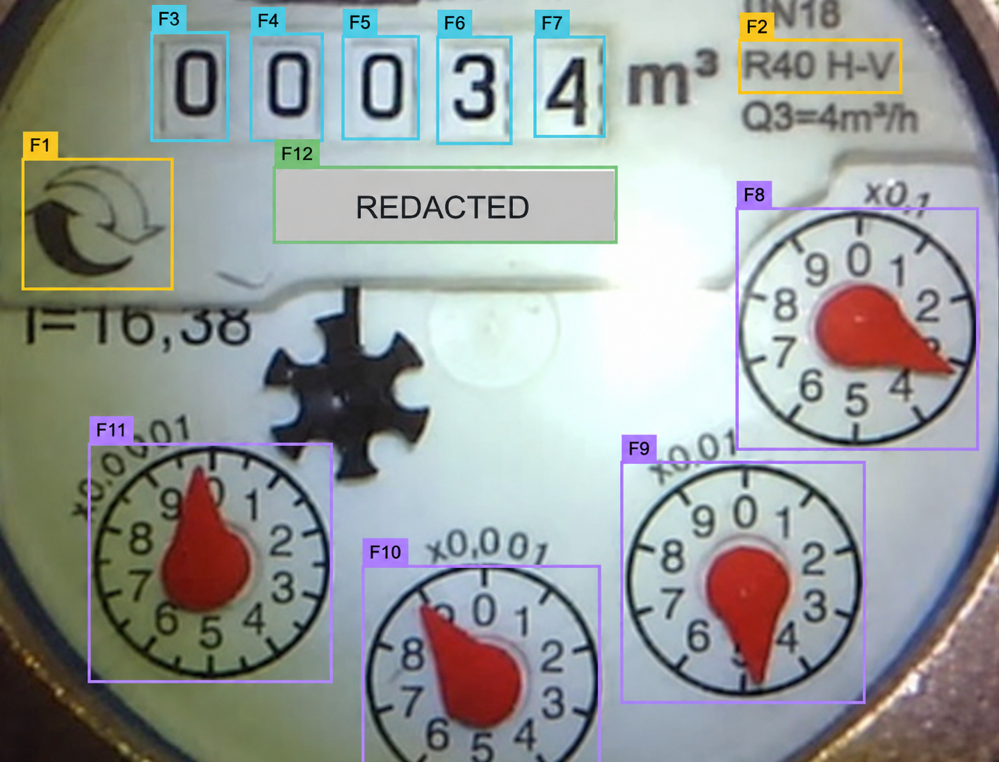
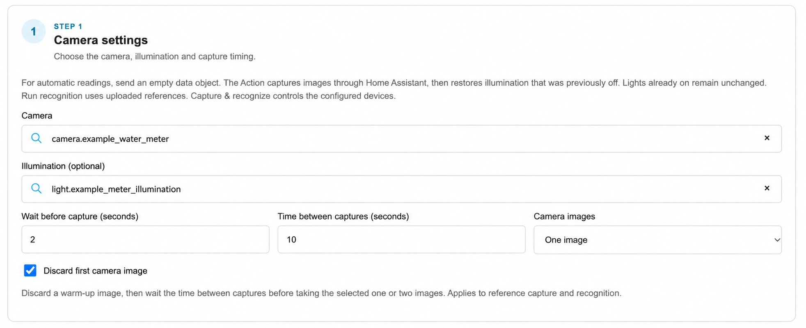
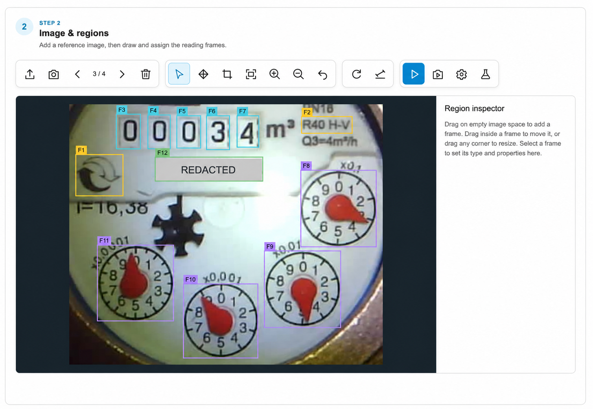
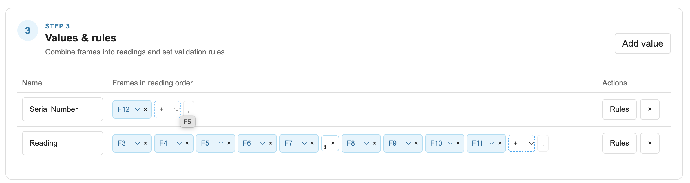
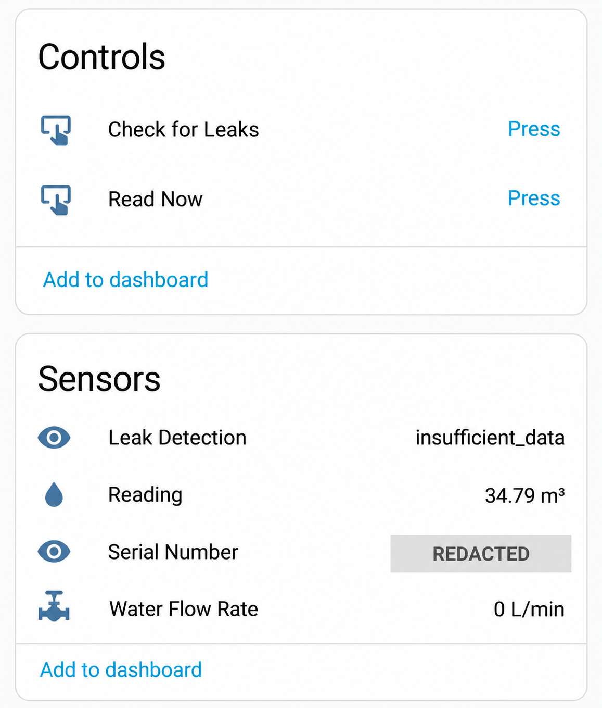

# AI-on-the-Edge Meters for HA AI Studio

Turn camera images of a mechanical meter into Home Assistant sensor readings. Configure the reading regions visually, test recognition, and let an [HA AI Studio](https://github.com/ha-ai-studio/ha-ai-studio) Device measure at a regular interval. Image processing and recognition run locally.

This repository includes two Actions and two ready-to-configure Device templates:

| Component | What it does |
| --- | --- |
| **Analog Meter Reader** | Reads mechanical digits, decade dials and printed digit sequences such as serial numbers. |
| **Leak detection** | Checks the Home Assistant history of a cumulative water sensor for sustained consumption patterns. |
| **Digital Watermeter** template | Combines a serial number, cumulative reading, derived flow rate and **Read Now** function. |
| **Water meter with leak checks** template | Adds leak status and a **Check for Leaks** function using a separate Action. |

The reader is adapted from [jomjol/AI-on-the-edge-device](https://github.com/jomjol/AI-on-the-edge-device). It runs inside HA AI Studio.



*Meter detail from the example below; image edited for privacy.*

## Before you start

You need:

- A current **HA AI Studio** installation on Linux amd64, connected to Home Assistant.
- A Home Assistant **`camera.*` entity** showing your meter with stable framing, focus and lighting. Capture reference images directly in the editor, or upload a PNG/JPEG to try recognition without a camera.
- Optional illumination exposed as a Home Assistant **`light.*` or `switch.*` entity**.

Start with one cumulative reading. Add serial-number recognition and leak checks once that reading works reliably.

## 1. Install the Actions

1. Open **Settings → Action repositories** in HA AI Studio.
2. Add a **GitHub Release** source with this repository URL:

   ```text
   https://github.com/ha-ai-studio/ha-ai-studio-actions-ai-on-the-edge-meters
   ```

3. Select `latest` for the latest published stable release, or enter an explicit stable release tag.
4. Refresh the repository to load the Action types and Device templates.
5. Open **Actions → Create action**, give it a name and select **Analog Meter Reader**. Open its configuration page.

Refreshing the repository updates the catalog; it does not upgrade existing Actions.

## 2. Add a reference image

Select your camera in **Camera settings**, optionally select illumination and configure the wait before capture. Then choose **Capture reference images**. Alternatively, choose **Add reference image** to upload a PNG/JPEG.

Capture uses the selected camera and illumination. If the Action turns a light on, it turns it off again afterward; lights that were already on stay on.



Example camera settings; entity names edited for privacy.

Adjust the image if needed before drawing frames:

1. Use **Rotate 90°** if needed.
2. Use **Straighten image** and draw along a line that should be horizontal.
3. Use **Crop image** to remove irrelevant surroundings, leaving space around the meter for alignment. Select **Apply crop**.

Use a sharp, evenly lit image without reflections over digits or pointers. The same rotation, straightening and crop apply to later captures.

## 3. Draw and assign frames

In **Select / move**, drag on empty image space to draw a frame. Select it and choose its type under **Region properties**. Move a frame by dragging inside it; resize it with its corner handles.

| Frame type | What to select |
| --- | --- |
| **Alignment reference** | A small, distinctive fixed feature, such as a printed mark. Create exactly two, away from moving digits and pointers. |
| **Digit** | One mechanical number wheel. Draw a separate frame for each digit. |
| **Analog dial** | One decade dial. Check its direction; counter-clockwise is configured per dial. |
| **Number block** | One complete printed sequence, such as a serial number. Leading zeros are preserved. |

Alignment references let the reader compensate for small shifts between images. Keep all frames inside the crop.



F1–F2 are alignment references, F3–F7 read mechanical digits, F8–F11 read decade dials, and F12 reads the serial number. The serial number is redacted for privacy.

## 4. Build the reading values

Under **Values & rules**, choose **Add value** and name the reading. Use the **+** selector to add frames in reading order, from the most significant to the least significant position. Insert a comma where the fractional part begins.

- Put mechanical digits before analog dials so transition correction can work.
- Each frame can belong to only one value.
- To read a serial number, create a separate value containing only its **Number block** frame, with no comma. Its result is text, so `001234` stays `001234`.
- Optional change and rate checks are under **Rules**. They require a previous reading; see the [recognition reference](docs/recognition-reference.md#input) before enabling them.

You can find each value's ID under **Test options**. Keep these IDs handy when assigning Device sensors in step 6.



For the meter shown above, use F12 alone for **Serial Number**. **Reading** combines `F3 F4 F5 F6 F7 , F8 F9 F10 F11`: five integer positions followed by four fractional dial positions.

## 5. Test recognition

Use **Run recognition** to test the selected reference image, or **Capture & recognize** to take fresh images with the configured camera and illumination. Both use your draft settings without updating Device readings or publishing MQTT.

Check the result against the meter image. The downloadable JPG report shows alignment, frame crops and reasons for rejected readings.

Test several images with different lighting and digit positions. Add them with **Add reference image** and switch between them to repeat recognition. They must have matching image dimensions and share the same frame layout. The selected image becomes the active reference when you save.

Start with the default **Recognition settings**. If needed, adjust image preparation, fit thresholds or frame-stability checks using the report. When **Require two matching captures** is enabled, use a camera test to check confirmation; a single reference image cannot confirm a reading.

Save once the readings are reliable across your test images.

## 6. Create a Device and expose it to Home Assistant

An **Action** defines how to obtain readings. A **Device** defines the sensors, measurement interval and Execute functions that use those readings.

1. Return to **Devices → Create Device** and select the water-meter template below the Device name.
2. Assign your **Analog Meter Reader** Action. The basic template supplies serial number, cumulative reading, derived flow rate and **Read Now**.
3. Match each sensor's reading ID to the value IDs from your Action. Replace the template's example IDs with your own. Remove the serial-number sensor if you did not configure that value.
4. Check the units and measurement interval. The template defaults to **15 minutes**, reading in **m³**, and derived flow rate in **L/min**. Its rate conversion factor is **1000**; adjust it if you use different units. Flow rate is derived from changes in the cumulative reading over time.
5. Save and activate the configured Action and Device when ready for real measurements.
6. To expose the Device to Home Assistant, configure **Central Discovery** on the intended broker in Studio Settings and explicitly enable publication for the Device.

**Read Now** invokes the selected Action and updates only that Action's sensors on the Device. It does not reset the measurement schedule. Home Assistant owns automation conditions, notifications and follow-up actions.



The published Device in Home Assistant, shown with optional leak detection. Serial number redacted for privacy.

## Optional: add leak detection

Create a separate **Leak detection** Action and select the cumulative Home Assistant water sensor. It must use **L** or **m³**, have state class `total` or `total_increasing`, and have enough Recorder history for the configured time window. Use the cumulative reading, not the derived flow-rate or serial-number sensor.

Choose the Device template with leak checks and assign your meter-reader and leak-detection Actions. It adds the `leak-status` reading and a **Check for Leaks** function.

| Status | Meaning |
| --- | --- |
| `normal` | The configured sustained-consumption pattern was not found. |
| `suspected_leak` | Consecutive recorded intervals exceeded the configured threshold for the required duration. |
| `insufficient_data` | History was missing, stale, too sparse or otherwise unsuitable for assessment. |

A newly published sensor needs time to accumulate history. Sparse history can produce `insufficient_data`, and `normal` does not rule out a leak. Configure notifications and other follow-up actions in Home Assistant.

See [Leak detection requirements and behavior](actions/water-leak-detection/README.md) for thresholds, history gaps and limitations.

## Troubleshooting

| Symptom | What to check |
| --- | --- |
| Action type or editor is missing | Refresh the GitHub Release source and select a stable release. |
| Camera capture is unavailable | Check the Home Assistant connection and selected camera entity. |
| First capture is dark or stale | Increase the illumination wait or try **Discard first camera image**. |
| Alignment fails | Use two distinctive fixed features, check crop bounds, and inspect search radius and match threshold in an alignment frame's inspector. |
| Digits or dials are unreadable | Inspect the report, focus, reflections, frame bounds and reading order before changing thresholds. |
| Serial number is unreadable | Check image clarity, frame bounds and any configured expected length or value. |
| Reference test shows no confirmed value | With two-capture confirmation enabled, use **Capture & recognize**; one reference cannot confirm a reading. |
| Device sensor has no reading | Check Action/Device activation and match the sensor reading ID to the Action's value ID. |
| Device is absent from Home Assistant | Check Central Discovery, the chosen broker and explicit Device publication. |
| Leak status is `insufficient_data` | Check Recorder history, units, state class and allowed gaps. Unchanged sensor states may not be recorded. |

## Further reading

- [Recognition and runtime reference](docs/recognition-reference.md): request examples, quality checks, image alignment, camera acquisition and runtime limits.
- [Development and releases](docs/development.md): editor builds, local sources, tests and packaging.
- [Changelog](CHANGELOG.md): release changes.

## License and attribution

This repository uses the unchanged **Dual Use License for AI-on-the-Edge Device**, version 1.0 (2025-01-05), in [LICENSE.md](LICENSE.md). Credit goes to **jomjol and all contributors**. This is an independent adaptation, not an official upstream release. See [THIRD_PARTY.md](THIRD_PARTY.md) for code and model provenance. HA AI Studio is a separate repository and retains its own license.
